### Hi there! 👋

My name is Pantelis and I'm a medical imaging enthusiast!

---
### How to reach me 📱

---
### Stats 📊

&nbsp;

---
### Bonsai 🪴

<picture>
  <source media="(prefers-color-scheme: dark)" srcset="bonsai/bonsai-dark.svg">
  
</picture>

